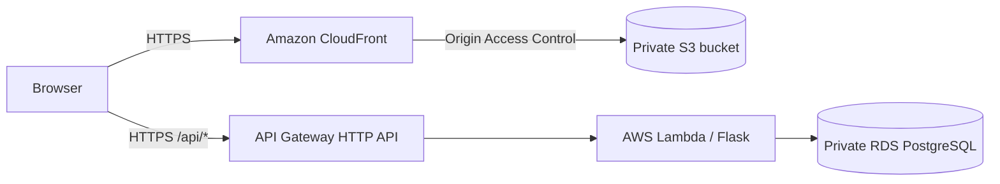

# NASE-842 — RealWorld Frontend

**Vue 3 + TypeScript + Vite | AWS S3 + CloudFront | GitHub Actions**

This repository contains the browser application for **NASE-842**, a DevOps final-assessment project that adapts the open-source [RealWorld / Conduit](https://github.com/gothinkster/realworld) blogging app and deploys it to AWS.

**Project focus:** integrate and deploy an existing full-stack application with secure cloud infrastructure, reproducible configuration, and automated application delivery. The underlying Vue app was originally created by [mutoe/vue3-realworld-example-app](https://github.com/mutoe/vue3-realworld-example-app); this repository is an adapted deployment, not a claim that the frontend was written from scratch.

| Link | Address |
| --- | --- |
| Deployed website | https://realworld.eldeeb-o-skillup.vertexlab.net |
| Production API | https://api.realworld.eldeeb-o-skillup.vertexlab.net |
| Flask backend source | [nase842-backend](https://github.com/OmarElDeeb-exe/nase842-backend) |
| Terraform infrastructure | [nase842-infra](https://github.com/OmarElDeeb-exe/nase842-infra) |
| Frontend deployment workflow | [.github/workflows/deploy.yml](.github/workflows/deploy.yml) |

## What the application does

The frontend provides the RealWorld blogging interface: article feeds and reading, user registration/login, article editing, profiles, tags, and other RealWorld interactions. Vue calls a separate Flask API; user accounts and article data are persisted in PostgreSQL, **not** in the S3 bucket.

## How the deployed frontend works



- **S3:** stores the production `dist/` HTML, CSS, and JavaScript assets. The bucket has public access blocked.
- **CloudFront:** delivers the app via HTTPS, accesses S3 using Origin Access Control (OAC), and serves `index.html` for Vue Router deep links.
- **Vite configuration:** `src/config.ts` reads `VITE_API_HOST`; `src/services/index.ts` uses it to call `/api` on the Flask backend. `.env.production` contains the **public API URL only**, not a secret.
- **Route 53 + ACM:** provide the custom domain and TLS certificate; their resource definitions are in the infrastructure repository.

## Run locally

Requirements: Node.js **20+**, [pnpm](https://pnpm.io/) **10.33.0**, and a running compatible RealWorld backend.

```bash
git clone https://github.com/OmarElDeeb-exe/nase842-frontend.git
cd nase842-frontend
corepack enable
pnpm install --frozen-lockfile

# Optional: point development requests at your local Flask API.
printf 'VITE_API_HOST=http://127.0.0.1:8080\n' > .env.local

pnpm dev
```

The Vite development server uses **port 4173**. If you use the local API, start the backend and database first (see the [backend README](https://github.com/OmarElDeeb-exe/nase842-backend#readme)). `.env.local` is for your workstation; do not commit credentials into Vite environment variables, because `VITE_*` variables are exposed to browser builds.

Useful commands:

```bash
pnpm build         # Production assets in dist/
pnpm type-check    # Vue / TypeScript checks
pnpm test:unit     # Existing unit tests
pnpm test:e2e      # Existing Playwright E2E suite (requires browser setup)
```

These commands are available locally; the **deployment workflow currently builds and deploys** but does not run the full test suite automatically.

## Continuous deployment

Source: [.github/workflows/deploy.yml](.github/workflows/deploy.yml)

A push to `main` normally triggers:

1. Checkout, install pnpm / Node, and install locked dependencies.
2. Build Vue into `dist/`.
3. Assume the dedicated AWS deployment IAM role through **GitHub OIDC** (no stored long-lived AWS access keys).
4. Confirm the expected AWS account, then sync assets to the private S3 bucket.
5. Upload `index.html` with a no-cache policy and invalidate the CloudFront distribution.

The IAM permissions for this workflow are defined in [github-frontend-iam.tf](https://github.com/OmarElDeeb-exe/nase842-infra/blob/main/github-frontend-iam.tf). A successful GitHub Actions run proves the pipeline completed; use the application and API smoke tests below to verify runtime behavior.

## Verify deployment

```bash
# Frontend served successfully over HTTPS
curl -fsS -o /dev/null -w 'Frontend: HTTP %{http_code}\n' \
  https://realworld.eldeeb-o-skillup.vertexlab.net/

# Backend connection/health
curl -fsS https://api.realworld.eldeeb-o-skillup.vertexlab.net/api/ping

# Dynamic articles response
curl -fsS https://api.realworld.eldeeb-o-skillup.vertexlab.net/api/articles
```

For an end-to-end demonstration, create a test account, publish an article, refresh the page, and retrieve the same article in a new session. This exercises the browser, API Gateway, Lambda, and database together.

## Key files

| Path | Purpose |
| --- | --- |
| `src/` | Vue views, stores, routing, components |
| `src/config.ts` | API hostname configuration |
| `src/services/` | HTTP API client and request configuration |
| `.env.production` | Public production API base URL |
| `vite.config.ts` | Vite build and test configuration |
| `.github/workflows/deploy.yml` | S3/CloudFront deployment pipeline |

## Provenance and license

Adapted from [mutoe/vue3-realworld-example-app](https://github.com/mutoe/vue3-realworld-example-app) for the NASE-842 DevOps assessment, following the [RealWorld specification](https://github.com/gothinkster/realworld). The original contributors retain credit for their work; see the repository's [LICENSE](LICENSE). Infrastructure and deployment integration for this assessment are documented separately in [nase842-infra](https://github.com/OmarElDeeb-exe/nase842-infra).
